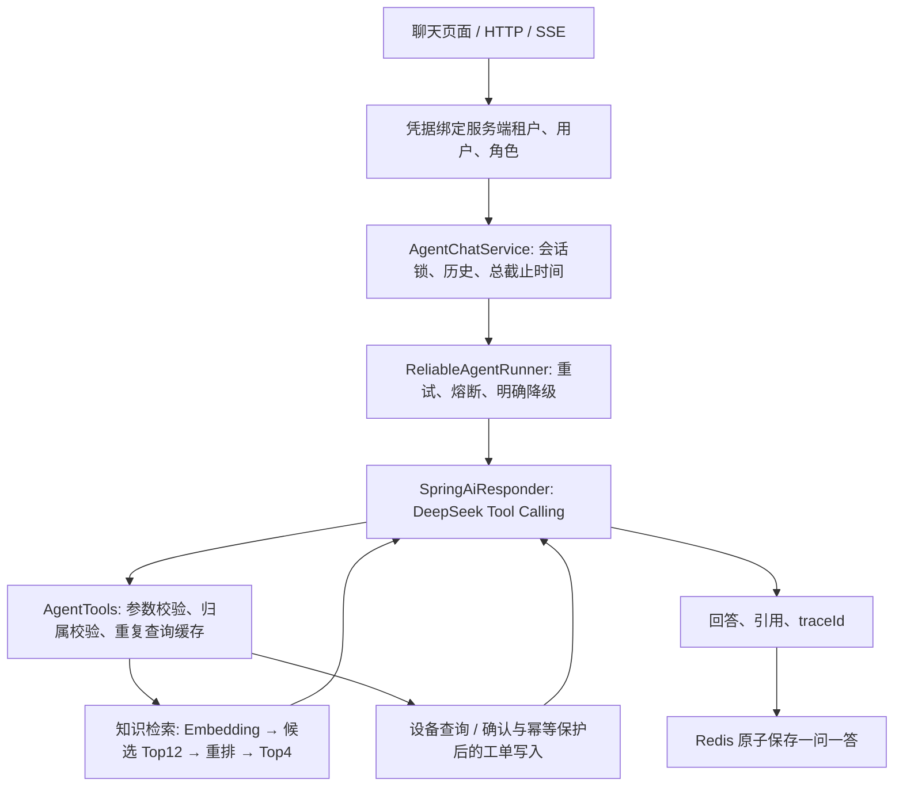

# Java AI 智能售后 Agent

面向扫地机器人售后的完整学习项目：用户用自然语言查手册、查设备、电量、耗材和工单，明确确认后创建报修工单。模型负责理解问题、选择工具和组织解释；Java 代码负责身份、数据权限、确认、事务、幂等和可靠性。

**从 [12 项能力学习路线](docs/LEARNING_PATH.md) 开始阅读。** 业务操作见 [用户手册](docs/USER_GUIDE.md)，实测证据见 [验证记录](docs/VERIFICATION.md)。

`dev` 分支新增设备选择与分页工单记录，完整体验步骤、接口及提交学习顺序见 [开发里程碑](docs/DEV_MILESTONES.md)。更新后请在 IDEA 重新构建并重启应用。

准备多人运行或面试并发问题，请读 [并发保护、正式运行与面试说明](docs/CONCURRENCY.md)：已加入共享全局/租户/用户额度、用户速率限制、会话续租及历史写入所有权检查、PostgreSQL 多实例知识更新事务保护。正式模式使用 `./scripts/configure-production.ps1` 准备凭据，再用 `./scripts/start-production.ps1` 启动；它与原来的学习模式分开。

## 技术栈与职责

| 技术 | 在项目中做什么 |
|---|---|
| Java 17 / Spring Boot 4.1.1 | HTTP 接口、配置、依赖注入、业务编排 |
| Spring AI 2.0.1 / DeepSeek | 对话模型接入、真实 Tool Calling 循环 |
| 本地 multilingual MiniLM / ONNX | 真正的 384 维中文语义 Embedding |
| PostgreSQL / pgvector / JPA | 设备、工单、知识清单、向量检索 |
| BM25 与向量分数融合 | 对召回候选重新排序，不是神经网络 Cross Encoder |
| Redis / Lua | 共享并发额度、滑动窗口、会话续租、原子校验归属后写入历史 |
| SSE / Micrometer / JUnit | 流式输出、指标、故障注入与集成测试 |
| 原生 HTML / CSS / JavaScript | 内置聊天页面，无需前端构建工具 |

## 在当前 Windows 工作区运行完整版

本次已准备模型和兼容 JDK，并更新 `SupportAgent_VMware` IDEA 运行配置。**重新加载 Maven，再重启 IDEA 中的应用**即可加载新代码及 `ai,postgres,redis,semantic` 四个 Profile。现有 DeepSeek 和虚拟机连接配置保留。

首次在另一台 Windows x64 机器准备：

```powershell
./scripts/prepare-java.ps1
./scripts/prepare-embedding.ps1
./scripts/configure-local.ps1
# 设置 DEEPSEEK_API_KEY、DB_URL/DB_USER/DB_PASSWORD、REDIS_HOST 等；
# 当前工作区的 start-local 会复用已有 IDEA 环境变量。
./scripts/start-local.ps1
```

打开 http://localhost:8080/ 。页面访问密钥默认 `demo-key`；它不是模型密钥。管理员和另一租户的凭据由 `configure-local.ps1` 生成并保存在忽略提交的 `.env.local`。不要将密钥提交仓库或复制到报告中。

JDK 下载固定版本并校验 SHA256，只放在 `data/runtime`，不修改系统 Java。旧 JDK 17.0.12 内附的 MSVC 运行库会导致本地 ONNX 加载失败，因此项目脚本优先使用已准备的 JDK。原生推理依赖首次初始化可能还会下载本地运行库。

## 四个 Profile 是独立开关

| 配置 | 实际行为 |
|---|---|
| 无 Profile | 确定性 Demo 应答、Hashing 测试向量、H2、内存会话 |
| `ai` | 启用真实 DeepSeek 对话及工具循环，单独启用不等于真实语义向量 |
| `semantic` | 启用本地真实 MiniLM Embedding |
| `postgres` | 持久化业务与向量库 |
| `redis` | 持久化会话及跨应用实例会话锁 |
| `ai,postgres,redis,semantic` | 当前完整版 |

模型失败时会明确降级告知，**不会暗中切换 Demo 伪造回答**。不带任何 Profile 的快速演示：

```powershell
. ./scripts/use-project-java.ps1
mvn -s maven-settings.xml spring-boot:run
```

Docker 部署见 `.env.example`、`docker-compose.yml`。选择 semantic 时先准备模型，Compose 将 `data/models` 只读挂载到容器；容器内路径与本地 Windows JDK 无关。

## 主要请求流程



## 验证与接口实验

```powershell
./scripts/verify-project.ps1                         # 不依赖 Redis/真实 Embedding 的测试
./scripts/verify-project.ps1 -WithRedis -WithSemantic # 含 Redis 和本地模型；PG 并发用下一条
./scripts/verify-project.ps1 -WithRedis -WithSemantic -WithPostgres # 包含 PostgreSQL 并发与事务回滚
```

已通过原有功能回归及新增并发测试，包含真实 Redis、真实本地向量模型、PostgreSQL 事务锁与回滚，以及本地 HTTP 工具协议和过载保护。最新数量与证据见 [并发验证](docs/CONCURRENCY.md)，之前的真实模型效果评测保留在 [验证记录](docs/VERIFICATION.md)。

在 [requests.http](requests.http) 可执行查询、写入确认、SSE、知识管理和评测。管理员操作必须使用管理员密钥；客户端填写 `X-Role: ADMIN` 不能提权。检索基线与重排报告存放于 `docs/evaluation-results/`，保留失败样本，不把离线分数包装成线上效果。

## 阅读文档

- [业务与操作手册](docs/USER_GUIDE.md)：谁使用、解决什么问题、如何体验。
- [12 项能力学习路线](docs/LEARNING_PATH.md)：按顺序读代码、动手实验、验证掌握程度。
- [架构与实现指南](docs/IMPLEMENTATION_GUIDE.md)：模块职责、数据流和安全边界。
- [本地虚拟机运行](docs/LOCAL_VM.md)：IDEA、环境配置、常见日志。
- [验证记录](docs/VERIFICATION.md)：测试命令、实测结果、尚未验证的部分。

## 工程边界

项目覆盖这 12 项能力的可运行实现与练习，不代表已完成生产认证。API Key 仍是静态账户注册表；重排为 BM25 融合，历史预算按字符而非精确 Token。熔断按进程维护；租约续期和共享限额已实现，但超时不能撤销已提交事务。当前同库 PgVector 与清单实现事务更新，换成独立向量服务仍需补偿。Redis Cluster 会话键适配、统一登录、数据库迁移、网关治理、人工质量评审和真实业务容量压测需按实际部署完成。

