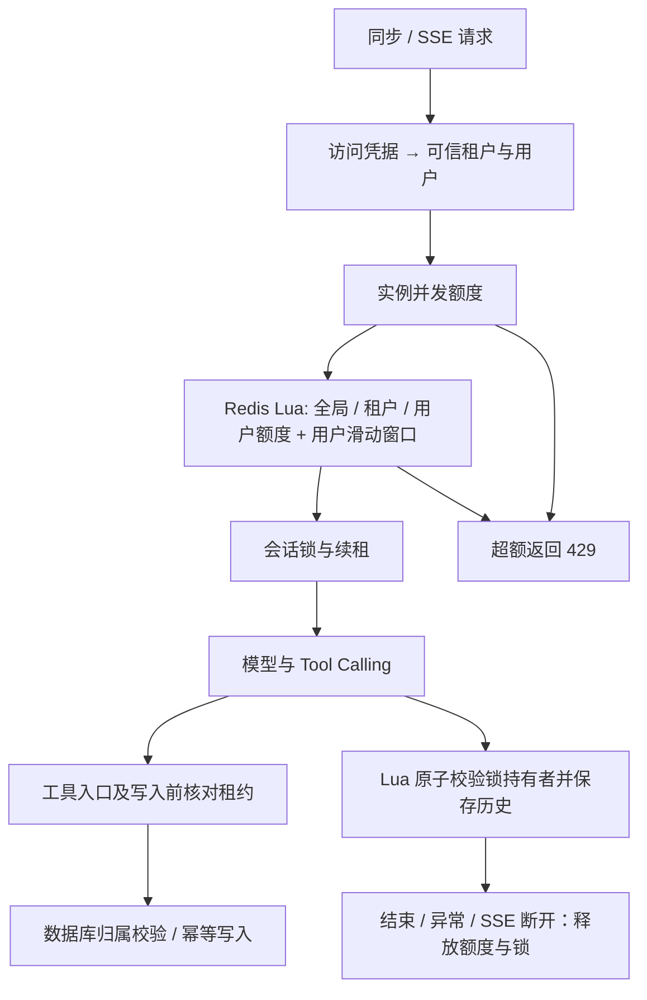

# 多人并发设计、运行与面试说明

更新：2026-10-13。本次增加的是应用并发保护与可重复验证，不能把配置的限额解释为已经验证的生产承载量。2026-10-12 的 44 项测试与模型效果评测属于前一版，当前并发结果见本文及 concurrency-results 目录。

## 1. 当前保护链路



服务端 API Key 绑定身份，不能靠客户端改 tenant/user 绕过限额。普通聊天、SSE 和启用时的模型评测都经过 AdmissionController；评测内部仍以测试用户身份运行，所以也消耗该用户额度。生产 Profile 默认关闭在线评测接口。

## 2. 默认值及准确含义

| 配置 / 环境变量 | 默认 | 含义 |
|---|---:|---|
| support.concurrency.instance-limit / SUPPORT_INSTANCE_LIMIT | 16 | 单应用实例允许的在途 Agent 请求数 |
| global-limit / SUPPORT_GLOBAL_LIMIT | 32 | 同一 Redis 命名空间下所有副本共享的在途额度 |
| tenant-limit / SUPPORT_TENANT_LIMIT | 16 | 每个租户最多在途请求数 |
| user-limit / SUPPORT_USER_LIMIT | 2 | 每个用户最多在途请求数，跨会话累计 |
| user-requests-per-minute / SUPPORT_USER_RPM | 120 | 每个用户过去 60 秒获准进入的请求数 |
| lease-seconds | 30 | 共享容量租约 TTL，正常运行自动续租 |
| namespace / SUPPORT_CONCURRENCY_NAMESPACE | default | 共享额度空间；正式配置脚本使用 support-production |

这些是保守的初始控制参数，**不是“支持 32 人在线”或“保证 32 路真实模型调用”的承诺**。一台实例首先受本地 16 限制；两台实例仍共用全局 32、租户 16、用户 2。在线而没有提问的用户不占模型调用额度。多个产品如果共用同一供应商账号额度，应统一预算或使用共同模型网关。

所有副本必须使用相同 Redis、命名空间和共享限额，否则就不属于同一额度域。令牌由应用随机生成，不接受客户端指定。拒绝请求不计入“获准请求”的滑动窗口，但仍会消耗入口 HTTP/认证资源；公网入口还需按 IP/身份进行网关限流。

线程池现在固定到实例额度，等待队列为 0，避免“先用 4 个线程、排满 100 才扩容”的长排队问题。SSE 不靠线程数限制在途量，和同步接口共用逻辑额度。线程池因取消不及时仍饱和时，同步调用明确拒绝，不能让调用方线程代替执行模型任务。

## 3. Redis 额度为什么不会竞争超发

RedisAdmissionController 使用一段 Lua 完成：

1. 使用 Redis TIME 取得统一时间，清理已过期的占用与 60 秒外的请求记录。
2. 同时检查全局、租户、用户三个 sorted set 的有效占用。
3. 检查用户滑动窗口。
4. 全部允许后，一次性向所有维度写入相同 token，并设置过期回收。

不是先 GET 数量、再 INCR 的两次客户端操作，所以两个应用副本同时申请时不会都读到旧数量。任一维度不足时，不会部分占用其他维度。

续租只更新仍存在且未过期的同一个 token，不能复活过期占用。释放只删除自己的 token，多次清理也不会多释放本地许可。实例崩溃后没有续租，过期占用会被后续申请清理。

未启用 redis 时使用同步临界区内存实现，只用于单进程演示和测试。production 不允许这样运行。

## 4. 会话锁：续租之外还要防旧请求写回

RedisConversationGuard 保留随机持有者 token，并交给 LeaseSupervisor 约每 TTL/3 续租。续租采用 compare-and-expire；释放采用 compare-and-delete。

当续租失败、Redis 不可达、锁被替换或 JVM 停顿超过已知有效期限时，租约被标记失效，AgentExecution 取消后续执行。工具入口和写入前还会同步核对租约，不单靠后台续租线程。失去保护时不能自动退回内存锁继续执行。

**只检查一次锁仍有时间窗口：**

```text
旧请求检查锁成功 → 锁随后过期/被替换 → 新请求进入 → 旧请求写入历史
```

因此，RedisConversationMemory 将“当前 token 是否仍持有锁”和“追加一问一答”放入同一个 Lua 脚本；旧请求即使刚刚通过本地检查，也不能覆盖新会话历史。

当前会话历史和锁沿用原有键名，原子脚本跨两个键，**支持当前单主 Redis / Sentinel 场景，不宣称兼容 Redis Cluster 跨槽执行**。容量 Lua 自身用了相同 hash tag，但要迁移整个应用到 Redis Cluster，还需统一迁移会话键的 hash tag 并验证故障切换。

Redis failover、网络分区与长时间 JVM 停顿不是强一致性魔法能消除的。续租与写前检查不能撤销已经开始或提交的数据库事务。工单仍依靠数据库唯一约束与请求内容校验防同键重复；对于资金等更严格场景，应增加数据库侧 fencing/version 及专门事务流程。

## 5. 知识更新：多实例协调与原子提交

KnowledgeWriteCoordinator 对同一索引命名空间、租户和文档生成稳定 64 位锁 ID，并在 PostgreSQL 事务里取得 pg_advisory_xact_lock。锁一直保持到事务提交或回滚；Java 方法退出前事务已完成。

同一事务包含：删除旧向量、删除旧清单、新向量写入、新清单写入。因此在本项目同一 PostgreSQL 数据源 + PgVectorStore 组合下，中途失败会回滚两部分数据。测试专门在旧内容删除后注入新向量写入失败，验证旧向量和清单仍存在。

同实例另有有限数量的本地分段锁，避免大量同文档请求占用数据库连接等待；冲突会拒绝。跨实例锁等待有 3 秒限制，事务/JDBC 语句有时间约束。不同文档可并发；极少数哈希碰撞最多导致额外串行化，不会让本应互斥的相同文档绕过锁。

这只对**同一 PostgreSQL 事务中的向量与业务存储**成立。默认 SimpleVectorStore 是内存对象，不具备数据库事务回滚能力；今后换独立向量服务时必须重新设计发布版本、Outbox/补偿，不能直接复用这个原子性结论。

## 6. HTTP、日志和指标

| 状态 | 含义 | 客户端行为 |
|---|---|---|
| 400 BAD_REQUEST | JSON、字段或业务请求格式错误 | 修正请求，不重试风暴 |
| 409 CONVERSATION_BUSY | 同一会话仍在执行 | 等该会话结束 |
| 429 CAPACITY_EXCEEDED | 实例/共享额度或用户速率不足 | 遵循 Retry-After: 5，可加随机退避 |
| 503 SERVICE_UNAVAILABLE | 并发保护失效、Redis 故障或数据库锁等待失败 | 暂停重试；涉及写入先核实结果 |
| SSE error | 流已开始后中断 | 不把已显示片段当成完整成功，不盲目重放写请求 |

保护失效不是普通“模型暂时慢”，不能计作成功业务结果。已有明确模型降级机制保留，HTTP 200 也可能是诚实的降级告知，因此压测要检查回答/事件而不只统计 200。

指标：support.admission.active 是当前实例活跃额度；support.admission.accepted/rejected 统计准入，rejected 的 scope 为 instance/global/tenant/user/rate 等有限维度，不把用户 ID 作为指标标签。已有 Agent 耗时、模型重试、降级、工具日志继续可用。SSE 结束时也记录请求耗时。

日志通过 traceId 关联额度拒绝、模型尝试、工具执行与租约丢失。后台续租日志显式附 traceId；不记录 token 或密钥。production 默认只暴露健康端点，Prometheus 采集应经私网/受保护入口单独开启。

## 7. 正式运行准备

```powershell
# 只生成本地随机访问凭据，保留已有值，不改变正在运行的应用。
./scripts/configure-production.ps1
# 已有 PostgreSQL 业务表、pgvector 扩展、模型文件以及数据库/模型连接配置：
./scripts/start-production.ps1
```

正式凭据保存在忽略提交的 .env.production.local；网页连接设置填写该文件中的普通用户访问密钥，不能继续用 demo-key，也不能填外部模型密钥。管理员密钥独立保存。

production 必须与 ai,postgres,redis,semantic 同时启用，拒绝短于 32 字符的访问凭据；脚本使用随机 32 字节生成凭据。生产不自动插入演示设备/知识，在线评测关闭，JPA 使用 validate，不在每次启动时自动改业务表。新数据库应在部署窗口预先准备并审查 schema；当前已有库可直接校验。PgVectorStore 的初始化权限也应在实际发布流程中收紧。

**多人使用要给每个人独立身份和凭据，不能把一个 demo-key 发给所有人。** 默认只有三个示例账户，增加用户需扩展 support.auth.accounts 配置，或接统一登录系统；同一凭据共享同一个用户额度和数据权限。当前仍是静态账户注册表，不是完整的注册、登录、密码找回系统。

原 docker-compose.yml 是本地开发基础设施示例，含开发数据库密码和端口映射，不应直接当公网生产部署文件。部署时使用私网 Redis/PostgreSQL、受控密钥、HTTPS 入口、审查过的数据库迁移与备份。本文的 production Profile 是安全配置起点，不等于已经替你完成公网部署。

## 8. 复现测试与容量验证

```powershell
./scripts/verify-project.ps1 -WithRedis -WithSemantic -WithPostgres
# 仅本地 HTTP 并发突发测试；模型使用 1 秒延迟替身，不调用收费模型：
. ./scripts/use-project-java.ps1
mvn -s maven-settings.xml '-Dtest=AgentConcurrencyLoadTest' test
```

真实 Redis 用两个独立准入对象模拟应用副本，验证原子共享额度、用户/租户限额、旧 token 释放和续租；不是用 mock Redis 代替。PostgreSQL 测试用独立协调器、不同事务连接验证锁，并创建随机向量表及隔离清单，结束后只清理自己的测试数据。

本地 HTTP 测试创建 32 个独立用户并同时发起请求，实例额度设置为 8，模型响应模拟耗时 1 秒。它验证过载时受控拒绝、执行峰值不超额、结束后额度可复用；报告在 target/concurrency-load-report.json。**该报告不能换算成真实 DeepSeek 的最大 QPS。**

上线前按实际模型、问题长度、工具轮次、目标机器逐级测试 4/8/16… 在途请求，分别记录成功、429、503、超时、降级、P95、Token 和费用、CPU/内存、Redis延迟、数据库连接等待。先确认供应商允许的额度，测试额度内的容量；大量被正确拒绝说明保护生效，不代表满足业务容量目标。复制更多应用实例也不能提高供应商账号额度。

## 9. 本次验收结果

2026-10-13 验收共 **63 项测试通过，0 失败、0 错误、0 跳过**：一次完整运行 62 项通过，随后新增 1 项“清单写入失败时新向量也回滚”用例，并重跑全部 3 项 PostgreSQL 测试通过。按最新 JUnit 文件去重汇总的结果见 [tests.json](concurrency-results/tests.json)。

本地 HTTP 突发结果：[local-http-load.json](concurrency-results/local-http-load.json)。32 客户端同时请求、实例额度 8、模型替身延迟 1 秒：8 成功、24 返回 429、意外响应 0、执行峰值 8、全部请求 P95 为 1487ms；突发结束后新请求成功。该 P95 混合成功与快速拒绝，不能充当成功请求 SLO，更不能解释成真实模型容量。

正式模式实测：[production-smoke.json](concurrency-results/production-smoke.json)。独立端口启动成功，健康 UP，新凭据解析到绑定身份，demo-key 返回 401，在线评测及公开 Prometheus 端点返回 404。本次没有对外部模型做收费压力测试，也没有替换原来的 IDEA 服务。

## 10. 面试回答示例

**“你怎么解决 Agent 并发问题？”**

“我把问题分成数据正确性和容量保护。数据上，服务端身份隔离会话和工具，Redis 会话锁自动续租，历史写入用 Lua 原子校验持有者，工单以数据库唯一约束实现幂等；知识更新用 PostgreSQL 事务锁协调多个实例，并在同一事务中更新向量和清单。容量上，入口有实例、全局、租户和用户额度，以及用户滑动窗口；同步和 SSE 共用，超额返回 429，Redis 失效时拒绝继续执行。”

**“有分布式锁为什么还要数据库幂等？”**

锁可能过期、网络可能分区、请求可能重试。锁维护执行顺序，唯一约束约束最终持久化结果，它们解决不同问题。同键重放还要核对所有者和业务内容，不能只返回第一条记录。

**“续租就绝对安全吗？”**

不是。JVM 长暂停会错过续租，Redis 切主可能丢失状态。必须拒绝失效请求的后续工作，历史写入需要原子所有权检查；不可撤销的外部动作仍需要数据库约束、版本或 fencing。

**“全局限额为什么不用普通计数器？”**

普通加减计数在实例崩溃时可能永久泄漏。这里每个占用有独立 token 与到期时间，Lua 一次检查所有维度，后台续租，崩溃后能回收。多 Key 必须考虑 Redis Cluster 槽位限制。

**“为什么不把线程池直接调到 1000？”**

线程不是供应商额度。大量等待会占连接和内存、加重超时与重试。先设置可承受的准入额度，及时拒绝，按数据逐步调整；异步/SSE 也必须限制在途请求。

**“你项目能支持多少并发？”**

“默认单实例准入 16、共享全局 32，这只是配置。已有 32 客户端突发的本地 HTTP 保护测试与真实 Redis/PostgreSQL 并发一致性测试；模型替身耗时固定 1 秒，不能宣称真实模型达到相同吞吐。正式容量要在目标模型和机器上按延迟、成功率及配额测定。”

**“哪些地方仍不是生产终态？”**

静态凭据注册表、单进程熔断、未适配 Redis Cluster 会话键、上游取消不能保证停止计费、第三方向量库的一致性，以及业务容量/SLO验收仍需实际系统补齐。能清楚说明这些边界，比说“加个锁就绝对安全”更可信。

